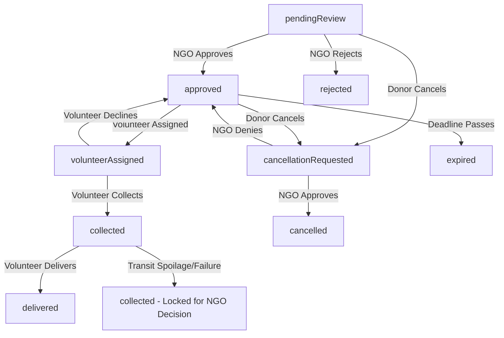

# FoodBridge — Surplus Food Donation & Distribution Platform (Frontend)

FoodBridge is a transparent, coordinated web application built to connect surplus food donors (restaurants, caterers, grocery stores, and households), verified non-governmental organizations (NGOs), and community volunteer couriers to rescue edible surplus food safely and deliver it to verified recipient facilities.

Developed with modern frontend architecture, reactive UI state machines, accessible responsive design, and auditable chain of custody.

---

## 1. Project Purpose & User Roles

FoodBridge streamlines food redistribution through four distinct, role-based workflows:

1. **Food Donor (`donor`)**
   - Submits surplus food donations with preparation details, portion counts, weight (kg), storage methods, packaging, allergens, pickup windows, and photos.
   - Monitors donation status changes with timestamped status history.
   - Can request donation cancellations prior to collection, requiring NGO justification and recorded resolution.

2. **NGO Officer (`ngo`)**
   - Registers non-profit organization credentials for verification.
   - Manages an active recipient directory (shelters, orphanages, community kitchens) with capacity tracking and contact information.
   - Reviews incoming surplus donations: inspects food safety, approves with delivery estimates, rejects with reasons, or requests correction.
   - Manages volunteer courier assignments, dispatches active tasks, and decides cancellation requests.
   - Records mandatory post-collection food handling decisions if transport failure occurs.

3. **Volunteer Courier (`volunteer`)**
   - Discovers assigned collection and transport tasks with pickup schedule, addresses, food quantity, and destination recipient details.
   - Accepts or declines assignments with recorded reasons.
   - Enforces **collection-before-delivery**: confirms physical pickup before drop-off can be initiated.
   - Confirms drop-off with receiver name, notes, and photo evidence, creating a delivery record.
   - Reports in-transit transport failures with mandatory reasons, locking the food donation to prevent unsafe redistribution.

4. **System Administrator (`admin`)**
   - Reviews and approves or rejects pending NGO applications.
   - Manages user accounts (suspends or reactivates users with documented justifications).
   - Monitors platform-wide operations and metrics.
   - Generates sanitized operational CSV reports.
   - Inspects platform audit logs.

---

## 2. Technology Stack

- **Core Framework**: React 18.3, TypeScript 5.6, Vite 5.4, React Router 6.28.
- **Styling & Design Tokens**: Tailwind CSS 3.4 (Forest Green `#174D3A`, Sage `#E8F2E8`, Cream `#FAF7F0`, Harvest `#D58B45`), Lucide React icons.
- **Client Storage & State**: Pure client-side data persistence with localStorage integration and pre-seeded demo records for all four roles.
- **Code Quality & Linting**: ESLint 9 (Flat Config) with typescript-eslint.

---

## 3. Project Structure

```
FoodBridge/
├── public/                             # Static assets and images
│   ├── favicon.ico
│   └── images/
│       ├── foodbridge-logo.png
│       └── hero-foodbridge.jpg
├── src/
│   ├── app/                            # Application routing & layout
│   │   ├── App.tsx                     # Top-level application component
│   │   └── router.tsx                  # React Router routes with ProtectedRoute
│   ├── components/                     # Reusable UI & role components
│   │   ├── admin/                      # Admin application review & suspension modals
│   │   ├── auth/                       # ProtectedRoute & RoleRedirect
│   │   ├── donor/                      # Donation creation form & details modal
│   │   ├── layout/                     # Header, Footer, PublicLayout
│   │   ├── ngo/                        # Donation review, volunteer dispatch & recipient manager
│   │   ├── ui/                         # Button, FormField, StatusBadge, FeedbackStates, PageHeader
│   │   └── volunteer/                  # Volunteer task detail & action modals
│   ├── context/
│   │   └── AuthContext.tsx             # User authentication & demo role session state
│   ├── pages/                          # Application views
│   │   ├── admin/                      # Admin dashboard & management views
│   │   ├── auth/                       # Login, Register, SuspendedAccount views
│   │   ├── donor/                      # Donor dashboard & DonateFood views
│   │   ├── ngo/                        # NGO coordination & application status views
│   │   ├── public/                     # Home, About, PrivacyTerms, NotFound views
│   │   └── volunteer/                  # Volunteer task dashboard & history
│   ├── services/                       # Data access & local mock storage
│   │   ├── authService.ts              # Local authentication & user profile operations
│   │   ├── storageService.ts           # Client photo/document handling with size validation
│   │   └── database/
│   │       ├── dataAccess.ts           # State queries, mutations & demo data store
│   │       └── transitions.ts          # State machine transitions & validation
│   ├── styles/
│   │   └── index.css                   # Tailwind directives & design tokens
│   └── types/                          # TypeScript definitions
│       ├── auth.ts                     # UserProfile, UserRole, AccountStatus, NgoApplication
│       └── database.ts                 # Donation, Assignment, Delivery, StatusHistory, AuditLog
├── package.json                        # Dependencies and scripts
├── tailwind.config.js                  # Tailwind design system configuration
├── tsconfig.json                       # TypeScript compiler configuration
└── vite.config.ts                      # Vite build configuration
```

---

## 4. Quick Start & Local Setup

### Prerequisites
- **Node.js**: v18.x or v20.x LTS
- **npm**: v9.x or higher

### Running Locally
1. Install dependencies:
   ```bash
   npm install
   ```

2. Start the Vite development server:
   ```bash
   npm run dev
   ```

3. Open your browser at `http://localhost:5173`.

---

## 5. Instant Demo Logins

The login page (`/login`) includes 1-click **Instant Demo Access** buttons for every user role:

| Role | Demo Account | Display Name |
| :--- | :--- | :--- |
| **Food Donor** | `donor@foodbridge.org` | Aarav Sharma |
| **NGO Officer** | `ngo@foodbridge.org` | Rohit Deshmukh (Annapurna Foundation) |
| **Volunteer Courier** | `volunteer@foodbridge.org` | Priya Patel |
| **Administrator** | `admin@foodbridge.org` | Platform Administrator |

You can also register a new user on the `/register` page at any time.

---

## 6. Available Scripts

| Command | Description |
| :--- | :--- |
| `npm run dev` | Starts the Vite development server |
| `npm run build` | Runs TypeScript type checking (`tsc`) and builds the production bundle |
| `npm run preview` | Previews the production build locally |
| `npm run lint` | Runs ESLint across all source files |

---

## 7. Valid Donation Lifecycle Transitions


